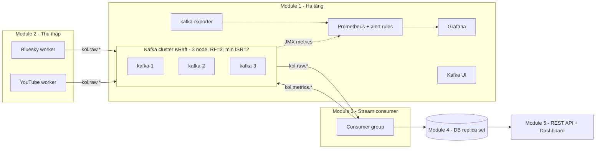

# Hệ thống Đánh giá KOL & Phân tích Tương tác Mạng Xã hội Thời gian thực

Hệ thống phân tán thu thập bài đăng/bình luận từ **Bluesky Firehose, YouTube Data API v3**, đệm qua **Kafka cluster**, xử lý luồng in-memory để tính điểm tương tác KOL và từ khóa/hashtag thịnh hành, lưu kết quả vào DB có replication và hiển thị trên dashboard gần thời gian thực.

Hệ thống **chạy trên Kubernetes** (minikube, không cần Docker). Repo gồm:
- **Module 1:** Kafka cluster, Kubernetes, giám sát và kiểm thử chịu tải.
- **Module 2:** thu thập Bluesky và YouTube.
- **Module 3:** tính điểm KOL và từ khóa thịnh hành.
- **Module 4:** PostgreSQL có replication và tự failover, lưu dữ liệu gốc và kết quả.

Module 5 (API và dashboard) chưa có; trong lúc chờ, Grafana có dashboard **KOL Leaderboard**.

**Cách cài đặt và chạy từng bước: [HDSD.md](HDSD.md).** Tình trạng các module: [Da_lam_va_con_thieu.md](Da_lam_va_con_thieu.md).



## Thành phần của Module 1

| Thành phần | Công nghệ | Vai trò |
|---|---|---|
| Kafka cluster | Apache Kafka 3.9 (KRaft, không ZooKeeper), 3 node | Message buffer chịu tải đột biến, replication factor 3 |
| Khởi tạo topic | `scripts/create-topics.sh` + `config/topics.conf` | Topic "as code", chạy idempotent |
| Kafka UI | kafbat/kafka-ui | Xem topic, message, consumer group, lag |
| Metrics broker | Prometheus JMX exporter (gắn sẵn vào image Kafka) | Throughput, latency, ISR, controller, JVM |
| Metrics consumer | kafka-exporter | Consumer lag theo group/topic/partition |
| Giám sát | Prometheus + 10 alert rules + Grafana dashboard dựng sẵn | Giám sát chịu tải, cảnh báo |
| Load test | `loadtest/` (Python, confluent-kafka) + Kafka perf tools | Sinh tải, đo throughput, ack latency, end-to-end latency |
| Chaos test | `scripts/chaos-broker-failure.sh` | Chứng minh chịu lỗi khi 1 broker chết |
| Kubernetes | Kustomize: StatefulSet + PVC + PDB + HPA (+ KEDA tùy chọn) | Auto-healing, auto-scaling |

## Yêu cầu

- Docker Desktop (Windows/macOS) hoặc Docker Engine + Compose v2 (Linux). Nên cấp **≥ 6 GB RAM** cho Docker.
- Kubernetes (tùy chọn): Docker Desktop Kubernetes / minikube / kind, `kubectl` ≥ 1.27.
- Windows: chạy các script `.sh` bằng **Git Bash**.

## Chạy trên Kubernetes (cách chính)

```bash
minikube start --driver=hyperv --container-runtime=containerd --cpus=6 --memory=10g   # Windows Pro
./scripts/build-images.sh minikube   # build 5 image bên trong minikube, không cần Docker
./scripts/k8s-deploy.sh              # Kafka, PostgreSQL (CloudNativePG), Module 2-4, giám sát
./scripts/k8s-expose.sh              # để mở: Kafka 127.0.0.1:30090-30092, Grafana :3000, Kafka UI :8080
```

Chi tiết: [docs/kubernetes.md](docs/kubernetes.md).

## Chạy nhanh bằng Docker Compose (tùy chọn, để thử trên một máy)

```bash
cp .env.example .env              # tùy chọn, mọi biến đều có giá trị mặc định
docker compose up -d --build      # build image Kafka + khởi động cluster và monitoring
docker compose ps                 # chờ kafka-1..3 "healthy", kafka-init "exited (0)"
docker compose logs kafka-init    # xem danh sách topic đã tạo
./scripts/cluster-status.sh       # quorum, topic, ISR, consumer group
```

| Dịch vụ | Địa chỉ |
|---|---|
| Kafka (từ máy host) | `127.0.0.1:9092,127.0.0.1:9093,127.0.0.1:9094` |
| Kafka (từ container khác trong network `kol-net`) | `kafka-1:19092,kafka-2:19092,kafka-3:19092` |
| Kafka UI | http://localhost:8080 |
| Prometheus (targets, alerts) | http://localhost:9090 |
| Grafana (dashboard "KOL Platform - Kafka Cluster & Load") | http://localhost:3000 (admin / admin) |
| kafka-exporter metrics | http://localhost:9308/metrics |

Dừng: `docker compose down` (giữ dữ liệu) · `docker compose down -v` (xóa sạch dữ liệu Kafka/Prometheus/Grafana).

## Topic

Định nghĩa trong [config/topics.conf](config/topics.conf). Muốn sửa thì sửa file này rồi chạy `docker compose up kafka-init`. Cluster tắt `auto.create.topics`, nên topic chưa khai báo sẽ bị từ chối.

| Topic | Partitions | Producer → Consumer |
|---|---|---|
| `kol.raw.bluesky` | 6 | Module 2 → Module 3 |
| `kol.raw.youtube` | 3 | Module 2 → Module 3 |
| `kol.metrics.kol-scores` (compacted, key = `kol_id`) | 3 | Module 3 → Module 4/5 |
| `kol.metrics.keywords` | 3 | Module 3 → Module 4/5 |
| `kol.dlq` | 3 | mọi module (message lỗi) |
| `kol.loadtest` | 6 | chỉ dùng cho load test |
| `kol.dev.sandbox` | 3 | kiểm tra kết nối, thử nghiệm |

Tất cả topic có RF = 3 và `min.insync.replicas = 2`, và có giới hạn dung lượng để không làm đầy đĩa. Format message (JSON) được đề xuất trong [config/schemas/social-event.schema.json](config/schemas/social-event.schema.json).

## Hạ tầng dùng chung của nhóm

Kafka và PostgreSQL chạy trên máy của một thành viên, cả nhóm truy cập qua Tailscale. Trên máy đó chỉ cần chạy `./scripts/shared.sh up`. Cách kết nối, tài khoản, sao lưu và giới hạn: [docs/shared-infrastructure.md](docs/shared-infrastructure.md).

Trên máy chủ đó, `shared.sh up` cũng bật `social-collectors` (cào dữ liệu) và `db-writer` (đọc `kol.raw.*` rồi ghi vào `kol.social_events` trong PostgreSQL). Dữ liệu vì vậy nằm ở một chỗ và cả nhóm dùng chung:

```bash
docker logs --tail=20 kol-db-writer
docker exec kol-postgres psql -U kol_admin -d kol -c 'SELECT platform, count(*) FROM kol.social_events GROUP BY platform;'
```

Collector trên máy chủ đọc cấu hình từ `.env.shared`, không phải `.env`. Lần đầu tạo file đó, `shared.sh` tự chép `YOUTUBE_API_KEY`, `YOUTUBE_CHANNEL_IDS`, `YOUTUBE_SEARCH_QUERIES`, `BLUESKY_HANDLES` từ `.env` sang. Nếu bỏ trống `YOUTUBE_API_KEY`, script in cảnh báo và chỉ Bluesky được thu thập:

```bash
./scripts/shared.sh info     # in lại thông tin kết nối + cảnh báo nếu thiếu key
```

## Thu thập dữ liệu (Module 2)

Collector chạy dưới profile `collectors` (Compose) hoặc Deployment `social-collectors` (K8s):

```env
COLLECTORS=bluesky,youtube
YOUTUBE_SEARCH_QUERIES=music,technology,football,entertainment,celebrity,politics
YOUTUBE_CHANNEL_IDS=
YOUTUBE_INCLUDE_COMMENTS=true
```

- **YouTube**: tìm video theo chủ đề hoặc theo `YOUTUBE_CHANNEL_IDS`, phân trang bằng `nextPageToken`. Mỗi video lấy `snippet,statistics,contentDetails,topicDetails,liveStreamingDetails` nên có thêm `topics`, `content_details` (duration/caption/definition) và `live_viewers`. `channels.list` bổ sung subscriber/video/tổng view vào `author.followers`, `author_videos`, `author_total_views`. Comment lấy khi `YOUTUBE_INCLUDE_COMMENTS=true`; reply lấy khi `YOUTUBE_INCLUDE_REPLIES=true` (tốn thêm quota). Giới hạn trang tách riêng: `YOUTUBE_SEARCH_MAX_PAGES` và `YOUTUBE_COMMENT_MAX_PAGES`.
- **Bluesky**: Jetstream firehose toàn mạng (post/reply/like/repost/follow/delete), tự reconnect, enrichment nội dung bài gốc cho like/repost. Mỗi bài có `media` (ảnh/video/link/bài trích dẫn), `facets` + `links` (tag/mention/link có offset chính xác từ nền tảng), `root_id` để dựng lại thread, và `cid`/`rev` để phát hiện bài bị sửa. Handle, tên hiển thị và follower count được lấy theo lô 25 DID/lần gọi và cache theo `BLUESKY_AUTHOR_CACHE_SECONDS`.

Cursor firehose chỉ được ghi **sau khi Kafka xác nhận** toàn bộ message trước nó, theo lô `BLUESKY_FLUSH_EVERY` event hoặc mỗi `BLUESKY_FLUSH_SECONDS` giây. Nếu có delivery lỗi, cursor giữ nguyên giá trị đã xác nhận, nên lần khởi động sau đọc lại từ đó và sinh vài event trùng (db-writer upsert theo `event_id`) thay vì mất dữ liệu. Payload hỏng hoặc không chuẩn hóa được đẩy sang `kol.dlq`, luồng thu thập vẫn tiếp tục.

## Xử lý luồng thời gian thực (Module 3)

Stream processor (`processor/`) đọc từ `kol.raw.bluesky` và `kol.raw.youtube` (`group.id = stream-processor`, at-least-once), lọc trùng bằng LRU cache `event_id`, tính điểm tương tác KOL và đếm tần suất từ khóa/hashtag trong cửa sổ trượt 15 phút, định kỳ mỗi 5 giây đẩy bản ghi cập nhật ra `kol.metrics.kol-scores` và `kol.metrics.keywords`:

```bash
docker compose --profile processor up -d --build
docker compose logs -f stream-processor
python processor/view_leaderboard.py          # xem bảng xếp hạng KOL & top từ khóa từ Kafka
```

Chi tiết kiến trúc, công thức tính điểm và schema đầu ra: [docs/module-3-stream-processor.md](docs/module-3-stream-processor.md).

## Kiểm thử chịu tải

```bash
# 1) Tải thực tế (JSON event), xem trực tiếp trên Grafana, hàng "Load test"
docker compose --profile loadtest up -d --build
LOADGEN_RATE=10000 docker compose --profile loadtest up -d                  # đổi tốc độ
docker compose --profile loadtest up -d --scale loadgen-producer=3          # 3 producer song song
docker compose logs -f loadgen-producer                                     # throughput, latency p50/p95/p99

# 2) Benchmark trần throughput bằng công cụ có sẵn của Kafka
./scripts/perf-test.sh
RECORDS=2000000 RECORD_SIZE=512 ACKS=1 ./scripts/perf-test.sh

# 3) Chịu lỗi: tắt 1 broker trong khi đang có tải
./scripts/chaos-broker-failure.sh kafka-2
```

Kịch bản test, cách đọc dashboard và mẫu báo cáo kết quả: [docs/monitoring-and-load-testing.md](docs/monitoring-and-load-testing.md).

## Kiểm thử chịu lỗi trên Kubernetes

Đo ngày 13/11/2026 trên minikube (một node, 6 CPU) với dữ liệu Bluesky thật:

| Kịch bản | Kết quả |
|---|---|
| Xóa pod `kafka-1` khi gửi tải `acks=all` | 35.231 message, **0 lỗi**; broker sẵn sàng lại sau 122 giây, đủ bản sao sau 179 giây |
| Kill đột ngột pod primary PostgreSQL | Có primary mới sau **40 giây**; db-writer và metrics-writer tự kết nối lại sau 51 giây, không mất dữ liệu |
| Khởi động lại Module 3 | 3.645 KOL được khôi phục điểm lũy kế từ PostgreSQL |

Chi tiết (auto-healing, scale, KEDA theo lag, truy cập từ ngoài): [docs/kubernetes.md](docs/kubernetes.md).

## Cấu trúc thư mục

```
.
├── docker-compose.yml          # Kafka x3 + init topic + UI + exporter + Prometheus + Grafana (+ loadtest profile)
├── docker-compose.shared.yml   # thêm PostgreSQL + sao lưu cho môi trường dùng chung
├── .env.example                # biến cấu hình (port, heap, tốc độ load test...)
├── config/
│   ├── topics.conf             # định nghĩa topic (dùng chung cho Compose & K8s)
│   ├── postgres/init/          # tạo tài khoản và schema PostgreSQL
│   └── schemas/                # JSON schema của event chuẩn hóa
├── docker/kafka/               # image Kafka + JMX exporter + rules
├── collectors/                 # Module 2: YouTube / Bluesky -> Kafka
├── processor/                  # Module 3: Stream consumer tính điểm KOL & từ khóa thịnh hành
├── dbwriter/                   # Module 4: Kafka -> PostgreSQL (schema.sql + consumer)
├── loadtest/                   # load generator (Python) + Dockerfile
├── monitoring/
│   ├── prometheus/             # prometheus.yml (Compose) + alerts.yml (dùng chung)
│   └── grafana/                # provisioning + dashboard JSON
├── k8s/
│   ├── base/                   # StatefulSet, Services, PDB, Job, UI, monitoring
│   ├── overlays/dev/           # giảm tài nguyên cho cluster local
│   ├── apps/                   # loadgen + HPA + template cho module khác
│   └── addons/keda/            # scale theo consumer lag (tùy chọn)
├── scripts/                    # shared (hạ tầng dùng chung), create-topics, cluster-status, perf-test, chaos, build, deploy
└── docs/                       # kiến trúc, hướng dẫn tích hợp, K8s, giám sát & load test
```

## Tài liệu

- [docs/shared-infrastructure.md](docs/shared-infrastructure.md): **hạ tầng dùng chung**: kết nối từ xa, PostgreSQL, sao lưu
- [docs/architecture.md](docs/architecture.md): thiết kế hạ tầng và các quyết định kỹ thuật (KRaft, RF/ISR, partition, listener)
- [docs/integration-guide.md](docs/integration-guide.md): **dành cho các module khác**: kết nối Kafka, cấu hình producer/consumer, format message
- [docs/module-3-stream-processor.md](docs/module-3-stream-processor.md): **Module 3 (Stream Processor)**: công thức tính điểm KOL, sliding window, schema đầu ra
- [docs/kubernetes.md](docs/kubernetes.md): triển khai, auto-healing, auto-scaling
- [docs/monitoring-and-load-testing.md](docs/monitoring-and-load-testing.md): metrics, alert, kịch bản load test và chaos test

## Xử lý sự cố nhanh

| Triệu chứng | Nguyên nhân / cách xử lý |
|---|---|
| `kafka-x` mãi `unhealthy` | Thiếu RAM: tăng RAM cho Docker hoặc giảm `KAFKA_HEAP_OPTS`. Xem `docker logs kafka-1`. |
| `Cluster ID mismatch` / `Invalid cluster.id` | Đã đổi `KAFKA_CLUSTER_ID` khi volume cũ còn: `docker compose down -v`. |
| `bash\r: No such file or directory` | File `.sh` bị đổi sang CRLF: `git add --renormalize .` (repo có `.gitattributes`) hoặc lưu lại dạng LF. |
| Client trên host không kết nối được | Dùng `127.0.0.1:9092,...` (host) và `kafka-1:19092,...` (container); không dùng lẫn hai loại. |
| `UNKNOWN_TOPIC_OR_PARTITION` | Topic chưa có trong `config/topics.conf` → thêm rồi `docker compose up kafka-init`. |
| `NOT_ENOUGH_REPLICAS` | Từ 2 broker trở lên đang chết (ISR < 2). Kiểm tra `./scripts/cluster-status.sh`. |
| Port 8080/3000/9090 bị chiếm | Đổi `KAFKA_UI_PORT`, `GRAFANA_PORT`, `PROMETHEUS_PORT` trong `.env`. |

## Nhóm

| Module | Nội dung |
|---|---|
| 1. Hạ tầng phân tán | Kafka cluster, container/Kubernetes, giám sát chịu tải *(repo này)* |
| 2. Thu thập dữ liệu | Worker đa luồng Bluesky / YouTube → Kafka |
| 3. Stream consumer | Tần suất keyword/hashtag, điểm tương tác KOL |
| 4. CSDL chịu lỗi | Schema, cluster replication, failover |
| 5. API & trực quan hóa | REST API + web dashboard |
