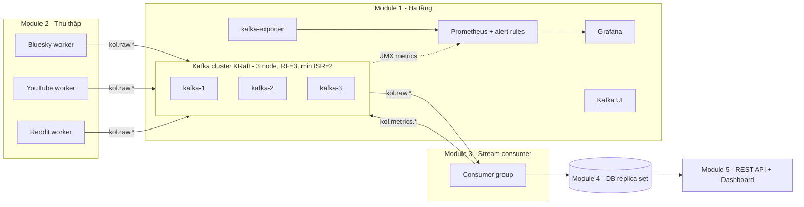

# Hệ thống Đánh giá KOL & Phân tích Tương tác Mạng Xã hội Thời gian thực

Hệ thống phân tán thu thập bài đăng/bình luận từ **Bluesky Firehose, YouTube Data API v3, Reddit API**, đệm qua **Kafka cluster**, xử lý luồng in-memory để tính điểm tương tác KOL và từ khóa/hashtag thịnh hành, lưu kết quả vào DB có replication và hiển thị trên dashboard gần thời gian thực.

Repo này hiện chứa **Module 1 – Hạ tầng phân tán**: Kafka cluster, môi trường container (Docker Compose) và Kubernetes, giám sát và kiểm thử chịu tải. Các module khác kết nối vào hạ tầng này theo [docs/integration-guide.md](docs/integration-guide.md).



## Thành phần của Module 1

| Thành phần | Công nghệ | Vai trò |
|---|---|---|
| Kafka cluster | Apache Kafka 3.9 (KRaft, không ZooKeeper), 3 node | Message buffer chịu tải đột biến, replication factor 3 |
| Khởi tạo topic | `scripts/create-topics.sh` + `config/topics.conf` | Topic "as code", chạy idempotent |
| Kafka UI | kafbat/kafka-ui | Xem topic, message, consumer group, lag |
| Metrics broker | Prometheus JMX exporter (gắn sẵn vào image Kafka) | Throughput, latency, ISR, controller, JVM |
| Metrics consumer | kafka-exporter | Consumer lag theo group/topic/partition |
| Giám sát | Prometheus + 10 alert rules + Grafana dashboard dựng sẵn | Giám sát chịu tải, cảnh báo |
| Load test | `loadtest/` (Python, confluent-kafka) + Kafka perf tools | Sinh tải, đo throughput, ack latency, end-to-end latency |
| Chaos test | `scripts/chaos-broker-failure.sh` | Chứng minh chịu lỗi khi 1 broker chết |
| Kubernetes | Kustomize: StatefulSet + PVC + PDB + HPA (+ KEDA tùy chọn) | Auto-healing, auto-scaling |

## Yêu cầu

- Docker Desktop (Windows/macOS) hoặc Docker Engine + Compose v2 (Linux). Nên cấp **≥ 6 GB RAM** cho Docker.
- Kubernetes (tùy chọn): Docker Desktop Kubernetes / minikube / kind, `kubectl` ≥ 1.27.
- Windows: chạy các script `.sh` bằng **Git Bash**.

## Chạy nhanh (Docker Compose)

```bash
cp .env.example .env              # tùy chọn, mọi biến đều có giá trị mặc định
docker compose up -d --build      # build image Kafka + khởi động cluster và monitoring
docker compose ps                 # chờ kafka-1..3 "healthy", kafka-init "exited (0)"
docker compose logs kafka-init    # xem danh sách topic đã tạo
./scripts/cluster-status.sh       # quorum, topic, ISR, consumer group
```

| Dịch vụ | Địa chỉ |
|---|---|
| Kafka (từ máy host) | `localhost:9092,localhost:9093,localhost:9094` |
| Kafka (từ container khác trong network `kol-net`) | `kafka-1:19092,kafka-2:19092,kafka-3:19092` |
| Kafka UI | http://localhost:8080 |
| Prometheus (targets, alerts) | http://localhost:9090 |
| Grafana (dashboard "KOL Platform - Kafka Cluster & Load") | http://localhost:3000 (admin / admin) |
| kafka-exporter metrics | http://localhost:9308/metrics |

Dừng: `docker compose down` (giữ dữ liệu) · `docker compose down -v` (xóa sạch dữ liệu Kafka/Prometheus/Grafana).

## Topic

Định nghĩa trong [config/topics.conf](config/topics.conf). Muốn sửa thì sửa file này rồi chạy `docker compose up kafka-init`. Cluster tắt `auto.create.topics`, nên topic chưa khai báo sẽ bị từ chối.

| Topic | Partitions | Producer → Consumer |
|---|---|---|
| `kol.raw.bluesky` | 6 | Module 2 → Module 3 |
| `kol.raw.youtube` | 3 | Module 2 → Module 3 |
| `kol.raw.reddit` | 3 | Module 2 → Module 3 |
| `kol.metrics.kol-scores` (compacted, key = `kol_id`) | 3 | Module 3 → Module 4/5 |
| `kol.metrics.keywords` | 3 | Module 3 → Module 4/5 |
| `kol.dlq` | 3 | mọi module (message lỗi) |
| `kol.loadtest` | 6 | chỉ dùng cho load test |

Tất cả topic có RF = 3 và `min.insync.replicas = 2`. Format message (JSON) được đề xuất trong [config/schemas/social-event.schema.json](config/schemas/social-event.schema.json).

## Kiểm thử chịu tải

```bash
# 1) Tải thực tế (JSON event), xem trực tiếp trên Grafana, hàng "Load test"
docker compose --profile loadtest up -d --build
LOADGEN_RATE=10000 docker compose --profile loadtest up -d                  # đổi tốc độ
docker compose --profile loadtest up -d --scale loadgen-producer=3          # 3 producer song song
docker compose logs -f loadgen-producer                                     # throughput, latency p50/p95/p99

# 2) Benchmark trần throughput bằng công cụ có sẵn của Kafka
./scripts/perf-test.sh
RECORDS=2000000 RECORD_SIZE=512 ACKS=1 ./scripts/perf-test.sh

# 3) Chịu lỗi: tắt 1 broker trong khi đang có tải
./scripts/chaos-broker-failure.sh kafka-2
```

Kịch bản test, cách đọc dashboard và mẫu báo cáo kết quả: [docs/monitoring-and-load-testing.md](docs/monitoring-and-load-testing.md).

## Kubernetes

```bash
./scripts/build-images.sh            # thêm "kind" hoặc "minikube" nếu dùng các cluster đó
./scripts/k8s-deploy.sh              # namespace kol-system: Kafka x3, topics job, UI, Prometheus, Grafana
kubectl apply -k k8s/apps            # load generator + HPA cho consumer
kubectl -n kol-system port-forward svc/grafana 3000:3000
```

Chi tiết (auto-healing, scale, KEDA theo lag, truy cập từ ngoài): [docs/kubernetes.md](docs/kubernetes.md).

## Cấu trúc thư mục

```
.
├── docker-compose.yml          # Kafka x3 + init topic + UI + exporter + Prometheus + Grafana (+ loadtest profile)
├── .env.example                # biến cấu hình (port, heap, tốc độ load test...)
├── config/
│   ├── topics.conf             # định nghĩa topic (dùng chung cho Compose & K8s)
│   └── schemas/                # JSON schema của event chuẩn hóa
├── docker/kafka/               # image Kafka + JMX exporter + rules
├── loadtest/                   # load generator (Python) + Dockerfile
├── monitoring/
│   ├── prometheus/             # prometheus.yml (Compose) + alerts.yml (dùng chung)
│   └── grafana/                # provisioning + dashboard JSON
├── k8s/
│   ├── base/                   # StatefulSet, Services, PDB, Job, UI, monitoring
│   ├── overlays/dev/           # giảm tài nguyên cho cluster local
│   ├── apps/                   # loadgen + HPA + template cho module khác
│   └── addons/keda/            # scale theo consumer lag (tùy chọn)
├── scripts/                    # create-topics, cluster-status, perf-test, chaos, build, deploy
└── docs/                       # kiến trúc, hướng dẫn tích hợp, K8s, giám sát & load test
```

## Tài liệu

- [docs/architecture.md](docs/architecture.md): thiết kế hạ tầng và các quyết định kỹ thuật (KRaft, RF/ISR, partition, listener)
- [docs/integration-guide.md](docs/integration-guide.md): **dành cho các module khác**: kết nối Kafka, cấu hình producer/consumer, format message
- [docs/kubernetes.md](docs/kubernetes.md): triển khai, auto-healing, auto-scaling
- [docs/monitoring-and-load-testing.md](docs/monitoring-and-load-testing.md): metrics, alert, kịch bản load test và chaos test

## Xử lý sự cố nhanh

| Triệu chứng | Nguyên nhân / cách xử lý |
|---|---|
| `kafka-x` mãi `unhealthy` | Thiếu RAM: tăng RAM cho Docker hoặc giảm `KAFKA_HEAP_OPTS`. Xem `docker logs kafka-1`. |
| `Cluster ID mismatch` / `Invalid cluster.id` | Đã đổi `KAFKA_CLUSTER_ID` khi volume cũ còn: `docker compose down -v`. |
| `bash\r: No such file or directory` | File `.sh` bị đổi sang CRLF: `git add --renormalize .` (repo có `.gitattributes`) hoặc lưu lại dạng LF. |
| Client trên host không kết nối được | Dùng `localhost:9092,...` (host) và `kafka-1:19092,...` (container); không dùng lẫn hai loại. |
| `UNKNOWN_TOPIC_OR_PARTITION` | Topic chưa có trong `config/topics.conf` → thêm rồi `docker compose up kafka-init`. |
| `NOT_ENOUGH_REPLICAS` | Từ 2 broker trở lên đang chết (ISR < 2). Kiểm tra `./scripts/cluster-status.sh`. |
| Port 8080/3000/9090 bị chiếm | Đổi `KAFKA_UI_PORT`, `GRAFANA_PORT`, `PROMETHEUS_PORT` trong `.env`. |

## Nhóm

| Module | Nội dung |
|---|---|
| 1. Hạ tầng phân tán | Kafka cluster, container/Kubernetes, giám sát chịu tải *(repo này)* |
| 2. Thu thập dữ liệu | Worker đa luồng Bluesky / YouTube / Reddit → Kafka |
| 3. Stream consumer | Tần suất keyword/hashtag, điểm tương tác KOL |
| 4. CSDL chịu lỗi | Schema, cluster replication, failover |
| 5. API & trực quan hóa | REST API + web dashboard |
