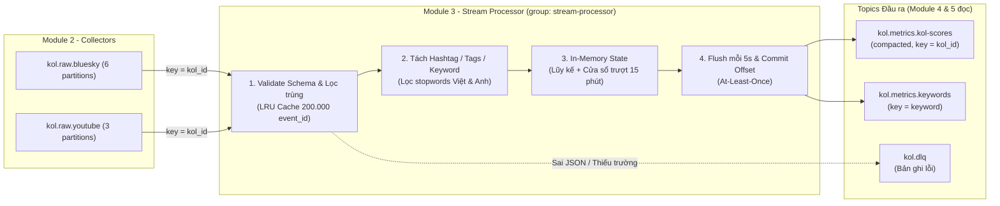

# Module 3 – Xử lý Luồng Thời gian thực (Stream Processor)

Tài liệu này mô tả thiết kế, cơ chế hoạt động, định dạng dữ liệu đầu ra và cách vận hành của **Module 3 (`processor/`)**, giúp các thành viên phụ trách **Module 1 (Hạ tầng)**, **Module 2 (Collectors)**, **Module 4 (CSDL PostgreSQL)** và **Module 5 (API & Dashboard)** nắm rõ luồng dữ liệu để phối hợp và tích hợp.

---

## 1. Module 3 làm gì trong hệ thống?

Sau khi **Module 2 (`collectors/`)** thu thập bài đăng, bình luận, lượt thích/chia sẻ/theo dõi từ **Bluesky Firehose** và **YouTube Data API v3** đẩy vào Kafka (`kol.raw.bluesky`, `kol.raw.youtube`), **Module 3 (`stream-processor`)** đóng vai trò bộ xử lý trung tâm:

1. **Đọc luồng sự kiện thô** từ `kol.raw.bluesky` (6 partitions) và `kol.raw.youtube` (3 partitions) với consumer group `stream-processor`.
2. **Kiểm tra hợp lệ & Chống trùng lặp (Deduplication)** ngay trong RAM theo `event_id`. Bản ghi hỏng đẩy sang `kol.dlq`.
3. **Tính toán trạng thái trong RAM (In-Memory Stateful Aggregation)** theo cả **Tổng lũy kế** và **Cửa sổ trượt 15 phút (Sliding Window)**:
   - Tính điểm tương tác (`engagement_score`, `window_score`) và tốc độ tăng trưởng mỗi phút (`velocity_per_min`) cho từng KOL.
   - Tách `#hashtag`, `tags`, `facets` và từ khóa có nghĩa từ nội dung bài viết để đếm tần suất từ khóa thịnh hành (trending keywords).
4. **Định kỳ mỗi 5 giây (`FLUSH_INTERVAL_SEC`)** đẩy các bản ghi có thay đổi ra 2 topic đầu ra cho **Module 4 (DB)** và **Module 5 (API/Dashboard)**:
   - `kol.metrics.kol-scores` (`key = kol_id`, bật log compaction — luôn giữ bản điểm mới nhất của mỗi KOL).
   - `kol.metrics.keywords` (`key = keyword`).



---

## 2. Cách chạy Module 3

### Chạy bằng Docker Compose (cùng cụm Kafka)
```bash
# Chạy riêng Module 3 trên nền cụm Kafka đã bật
docker compose --profile processor up -d --build

# Hoặc bật đồng thời cả Module 2 (cào dữ liệu thật) + Module 3 (tính điểm)
docker compose --profile collectors --profile processor up -d --build

# Xem log xử lý trực tiếp
docker compose logs -f stream-processor

# Nhân bản (scale) thành 3 instance song song để chia nhau 9 partitions
docker compose --profile processor up -d --scale stream-processor=3
```

### Xem nhanh Bảng xếp hạng KOL & Top từ khóa từ Kafka trên Terminal
```bash
python processor/view_leaderboard.py
# Hoặc nếu kết nối vào máy chủ dùng chung qua Tailscale:
python processor/view_leaderboard.py --bootstrap HOST:9092,HOST:9093,HOST:9094
```

### Chạy mô phỏng độc lập (Không cần bật Docker/Kafka) & Chạy Unit Test
```bash
python -m unittest discover -s processor/tests -v
python processor/demo_local.py
```

---

## 3. Hợp đồng dữ liệu đầu ra (Dành cho Module 4 & Module 5)

Module 3 xuất dữ liệu JSON UTF-8 ra 2 topic. Định nghĩa JSON Schema đầy đủ nằm tại [`config/schemas/kol-score.schema.json`](../config/schemas/kol-score.schema.json) và [`config/schemas/keyword-metric.schema.json`](../config/schemas/keyword-metric.schema.json).

### 3.1. Topic `kol.metrics.kol-scores` (Message key = `kol_id`)

Mỗi khi một KOL có sự kiện mới (hoặc sự kiện cũ trôi khỏi cửa sổ 15 phút), Module 3 đẩy bản cập nhật của KOL đó vào topic này:

```json
{
  "kol_id": "youtube:UC_khoai_lang_thang",
  "platform": "youtube",
  "handle": "@KhoaiLangThang",
  "followers": 2450000,
  "total_events": 49,
  "window_events": 18,
  "window_minutes": 15,
  "event_breakdown": {
    "post": 12,
    "comment": 21,
    "reply": 16,
    "like": 0,
    "repost": 0,
    "follow": 0,
    "delete": 0
  },
  "metrics_total": {
    "likes": 27210,
    "shares": 3316,
    "comments": 6594,
    "views": 384343
  },
  "metrics_window": {
    "likes": 9400,
    "shares": 1120,
    "comments": 2150,
    "views": 125000
  },
  "engagement_score": 67549.43,
  "window_score": 22742.0,
  "velocity_per_min": 1516.13,
  "top_hashtags": ["skincare", "tech", "routine", "gaming", "livestream"],
  "last_event_at": "2026-11-12T16:27:06.555+00:00",
  "updated_at": "2026-11-12T16:27:06.555+00:00"
}
```

**Ý nghĩa các trường quan trọng cho Dashboard (Module 5):**
- `engagement_score`: Tổng điểm tương tác tích lũy của KOL (dùng để xếp hạng **Top KOL toàn thời gian**).
- `window_score`: Điểm tương tác chỉ tính trong 15 phút gần nhất (dùng để xếp hạng **KOL đang thịnh hành / Trending KOLs**).
- `velocity_per_min`: Tốc độ tăng điểm trung bình mỗi phút trong cửa sổ hiện tại (`window_score / window_minutes`).
- `top_hashtags`: tối đa 5 hashtag xuất hiện nhiều nhất cùng KOL đó.

### 3.2. Topic `kol.metrics.keywords` (Message key = `keyword`)

Mỗi chu kỳ flush (5 giây), tối đa `TOP_KEYWORDS_LIMIT` (mặc định 100) từ khóa/hashtag có thay đổi và có tần suất cao nhất trong cửa sổ trượt sẽ được xuất ra:

```json
{
  "keyword": "skincare",
  "is_hashtag": true,
  "count": 76,
  "total_count": 210,
  "window_minutes": 15,
  "velocity_per_min": 5.07,
  "platforms": {
    "bluesky": 34,
    "youtube": 42
  },
  "unique_kols": 6,
  "updated_at": "2026-11-12T16:27:06.555+00:00"
}
```

**Ý nghĩa các trường:**
- `is_hashtag`: `true` nếu là thẻ `#hashtag` / `tags` / `facets`, `false` nếu là từ khóa tách từ nội dung văn bản (`text`).
- `count`: Số lần xuất hiện trong 15 phút gần nhất (giảm dần về 0 nếu không còn ai nhắc tới).
- `total_count`: Tổng số lần xuất hiện lũy kế.
- `platforms`: Số lần xuất hiện trong 15 phút qua trên từng nền tảng (`bluesky`, `youtube`).
- `unique_kols`: Số lượng KOL khác nhau có bài viết/tương tác chứa từ khóa này trong 15 phút qua.

---

## 4. Thuật toán & Quyết định kỹ thuật trong Module 3

### 4.1. Công thức tính điểm tương tác KOL (`ScoringWeights`)
Mỗi sự kiện hợp lệ của một KOL được tính điểm theo công thức:

$$\text{EventScore} = w_{\text{event}} + 1.0 \times \text{likes} + 3.0 \times \text{comments} + 5.0 \times \text{shares} + 0.01 \times \text{views}$$

Trong đó điểm gốc theo loại sự kiện ($w_{\text{event}}$):
- `post` = **5.0** · `follow` = **4.0** · `repost` = **3.0** · `comment` = **2.0** · `reply` = **2.0** · `like` = **1.0** · `delete` = **0.0**.
- Các trọng số này có thể điều chỉnh qua biến môi trường (`WEIGHT_LIKE_METRIC`, `WEIGHT_COMMENT_METRIC`, `WEIGHT_SHARE_METRIC`, `WEIGHT_VIEW_METRIC`...) mà không cần sửa code.

### 4.2. Vì sao tính toán trong RAM không bị lệch khi chạy nhiều Consumer?
- Module 2 (`collectors/`) publish mọi sự kiện với **Kafka message key = `kol_id`**.
- Kafka đảm bảo mọi message có cùng `kol_id` luôn đi vào **đúng một partition duy nhất** theo thứ tự thời gian.
- Nhờ vậy, mỗi instance `stream-processor` giữ toàn bộ trạng thái (`KOLRecord`) của các KOL thuộc partition được giao ngay trong RAM mà không cần khóa phân tán (distributed lock) giữa các container.

### 4.3. Cửa sổ trượt (Sliding Window) hoạt động thế nào?
- Mỗi `KOLRecord` và `KeywordRecord` lưu một hàng đợi hai đầu (`collections.deque`) chứa dấu thời gian (`timestamp`) và đóng góp của từng sự kiện trong `WINDOW_MINUTES` (15 phút).
- Khi có sự kiện mới hoặc đến chu kỳ flush (5 giây), hàm `evict_expired()` tự động cắt bỏ các mẫu cũ hơn `now - 15 phút` ở đầu `deque` và trừ tương ứng khỏi `window_score`, `metrics_window` và `count`.
- Chỉ những bản ghi có cờ `dirty = True` (vừa có sự kiện mới hoặc vừa hết hạn sự kiện cũ) mới được gửi ra Kafka để tiết kiệm băng thông.

### 4.4. Tách từ khóa & Lọc nhiễu (`processor/tokenizer.py`)
1. Lấy toàn bộ thẻ từ `hashtags`, `tags` (YouTube) và `facets` kiểu `tag` (Bluesky Jetstream) $\rightarrow$ đánh dấu `is_hashtag = True`.
2. Quét các thẻ `#tag` nằm trong nội dung `text` $\rightarrow$ đánh dấu `is_hashtag = True`.
3. Xóa URL (`http/https`), xóa `@mention`, tách các từ có độ dài $\ge 3$ ký tự và lọc qua bộ **Stopwords tiếng Việt (có dấu & không dấu) và tiếng Anh** (`processor/tokenizer.py`) $\rightarrow$ đánh dấu `is_hashtag = False`.

### 4.5. Độ bền dữ liệu: At-Least-Once, Deduplication & Rebalance-safe
- **Tắt auto-commit (`enable.auto.commit = False`)**: Chỉ gọi `consumer.commit()` sau khi đã đẩy kết quả sang `kol.metrics.*`.
- **Chống tính trùng (`DedupCache`)**: Lưu 200.000 `event_id` gần nhất theo cơ chế LRU. Nếu consumer khởi động lại hoặc rebalance và đọc lại vài message cũ, `DedupCache` phát hiện `event_id` đã xử lý và bỏ qua.
- **Xử lý khi Rebalance (`on_revoke`) & Tắt container (`SIGTERM`)**: Trước khi nhả partition cho consumer khác hoặc dừng container, `stream-processor` gọi `flush_and_commit(sync_commit=True)` để đẩy nốt dữ liệu trong RAM ra Kafka và commit offset đồng bộ.
- **Dead-Letter Queue (`kol.dlq`)**: Message sai JSON hoặc thiếu trường bắt buộc được bọc kèm nguyên nhân (`invalid_json`, `schema_validation`), partition và offset rồi gửi vào `kol.dlq`.

---

## 5. Giám sát (Prometheus Metrics)

Mỗi container `stream-processor` mở cổng `:8000/metrics` và được Prometheus tự động thu thập qua DNS discovery (`monitoring/prometheus/prometheus.yml`) hoặc Pod annotation trên Kubernetes (`k8s/apps/stream-processor.yaml`):

| Metric | Loại | Ý nghĩa |
|---|---|---|
| `processor_events_consumed_total{platform,event_type}` | Counter | Số sự kiện hợp lệ đã xử lý theo nền tảng & loại |
| `processor_events_deduplicated_total` | Counter | Số sự kiện trùng `event_id` đã lọc bỏ |
| `processor_dlq_messages_total{reason}` | Counter | Số message lỗi đẩy vào `kol.dlq` |
| `processor_kol_scores_published_total` | Counter | Số bản ghi điểm KOL đã xuất ra `kol.metrics.kol-scores` |
| `processor_keywords_published_total` | Counter | Số bản ghi từ khóa đã xuất ra `kol.metrics.keywords` |
| `processor_event_processing_seconds` | Histogram | Thời gian xử lý in-memory cho mỗi sự kiện |
| `processor_e2e_latency_seconds` | Histogram | Độ trễ từ lúc tạo message trên Kafka đến lúc Module 3 xử lý |
| `processor_active_kols` / `processor_active_keywords` | Gauge | Số KOL và từ khóa đang được giữ trong RAM |
| `processor_assigned_partitions` / `processor_rebalances_total` | Gauge / Counter | Số partition đang nắm giữ và số lần rebalance |

---

## 6. Những điểm cần phối hợp tiếp với các thành viên trong nhóm

1. **Với thành viên Module 4 (`dbwriter/` – PostgreSQL):**
   - Hiện tại `dbwriter/main.py` mới đọc `kol.raw.bluesky` và `kol.raw.youtube` để lưu sự kiện gốc vào bảng `kol.social_events`.
   - Để lưu thêm kết quả đã tính toán của Module 3 vào PostgreSQL phục vụ truy vấn lịch sử/API, `dbwriter` có thể subscribe thêm `kol.metrics.kol-scores` và `kol.metrics.keywords` (hoặc tách 1 consumer group `postgres-metrics-writer`) và upsert vào 2 bảng gợi ý sau:
     ```sql
     CREATE TABLE IF NOT EXISTS kol.kol_scores (
         kol_id            text        PRIMARY KEY,
         platform          text        NOT NULL,
         handle            text,
         followers         integer,
         total_events      integer     NOT NULL DEFAULT 0,
         window_events     integer     NOT NULL DEFAULT 0,
         window_minutes    integer     NOT NULL DEFAULT 15,
         event_breakdown   jsonb       NOT NULL DEFAULT '{}'::jsonb,
         metrics_total     jsonb       NOT NULL DEFAULT '{}'::jsonb,
         metrics_window    jsonb       NOT NULL DEFAULT '{}'::jsonb,
         engagement_score  double precision NOT NULL DEFAULT 0,
         window_score      double precision NOT NULL DEFAULT 0,
         velocity_per_min  double precision NOT NULL DEFAULT 0,
         top_hashtags      text[]      NOT NULL DEFAULT '{}',
         last_event_at     timestamptz,
         updated_at        timestamptz NOT NULL DEFAULT now()
     );

     CREATE TABLE IF NOT EXISTS kol.keyword_metrics (
         keyword           text        PRIMARY KEY,
         is_hashtag        boolean     NOT NULL DEFAULT false,
         count             integer     NOT NULL DEFAULT 0,
         total_count       integer     NOT NULL DEFAULT 0,
         window_minutes    integer     NOT NULL DEFAULT 15,
         velocity_per_min  double precision NOT NULL DEFAULT 0,
         platforms         jsonb       NOT NULL DEFAULT '{}'::jsonb,
         unique_kols       integer     NOT NULL DEFAULT 0,
         updated_at        timestamptz NOT NULL DEFAULT now()
     );
     ```
2. **Với thành viên Module 5 (REST API & Dashboard):**
   - Dashboard có thể lấy **Top KOL** và **Trending Keywords** theo 2 cách:
     - Truy vấn trực tiếp từ bảng `kol.kol_scores` và `kol.keyword_metrics` trong PostgreSQL (bằng tài khoản `kol_readonly`).
     - Hoặc dùng Kafka consumer đọc trực tiếp từ `kol.metrics.kol-scores` và `kol.metrics.keywords` để đẩy qua WebSocket/SSE lên giao diện theo thời gian thực (mỗi 5 giây).
3. **Với thành viên giữ máy chủ dùng chung (`scripts/shared.sh`):**
   - Sau khi merge nhánh Module 3 vào `main`, có thể thêm `stream-processor` vào `docker-compose.shared.yml` và lệnh `dc up` trong `scripts/shared.sh` để máy chủ dùng chung tự động chạy luôn Module 3 cho cả nhóm.
